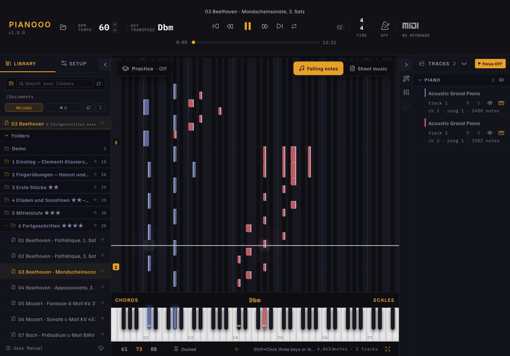
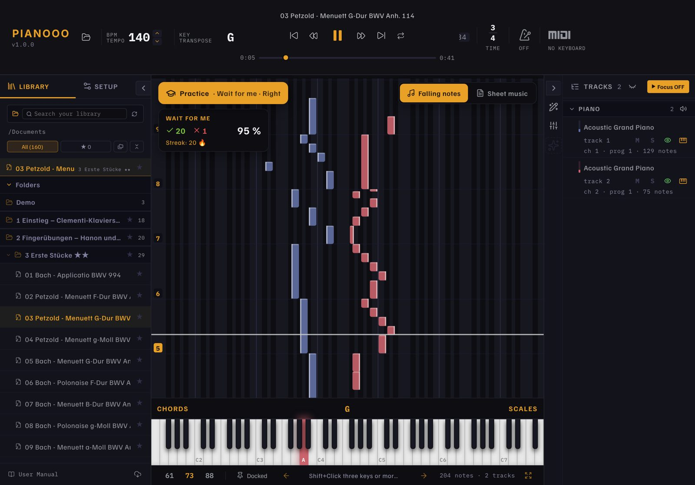
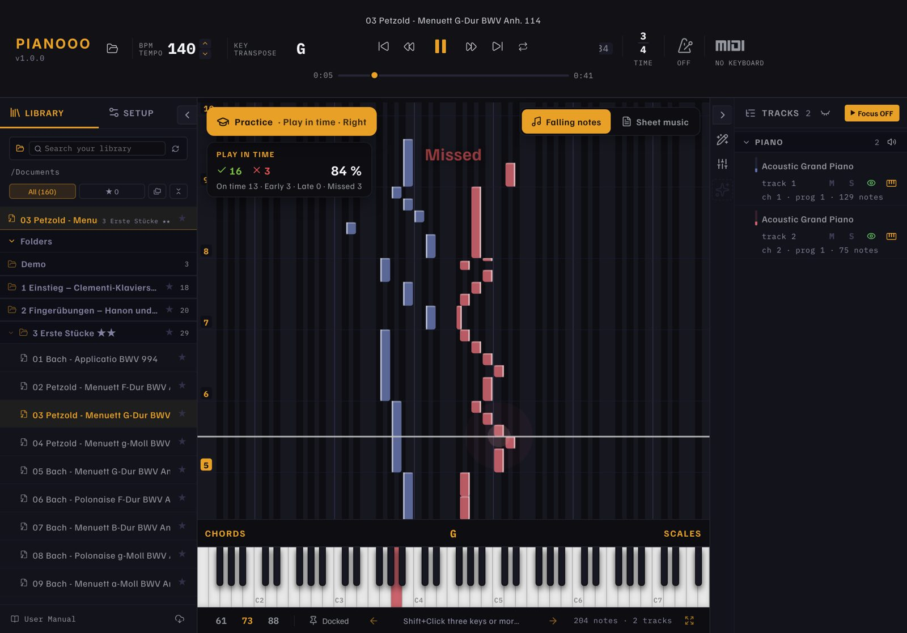
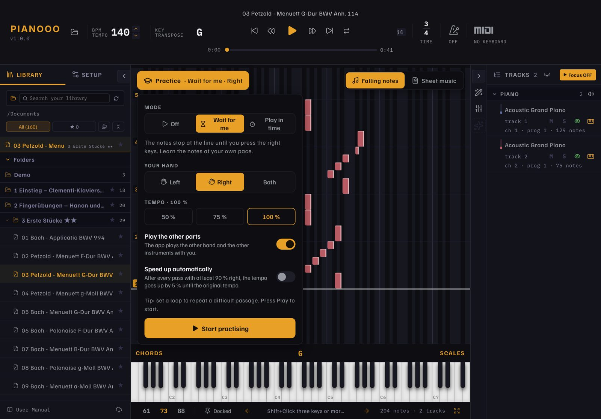
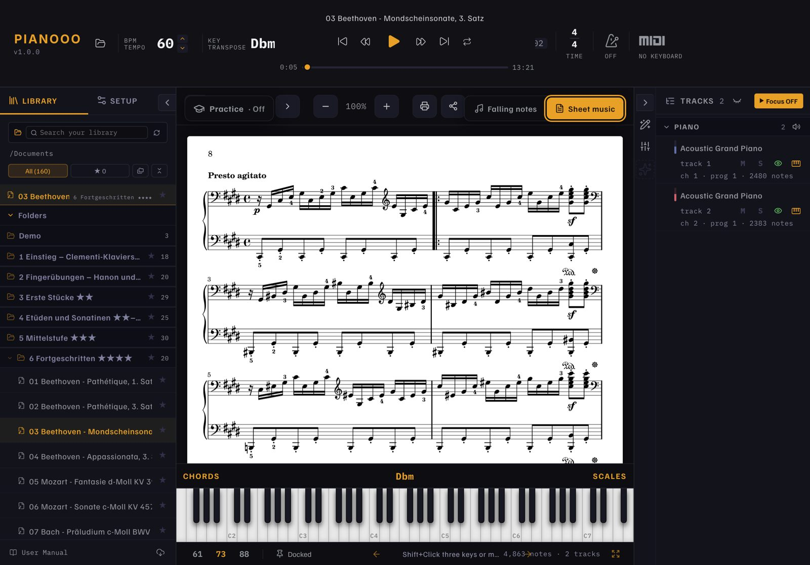
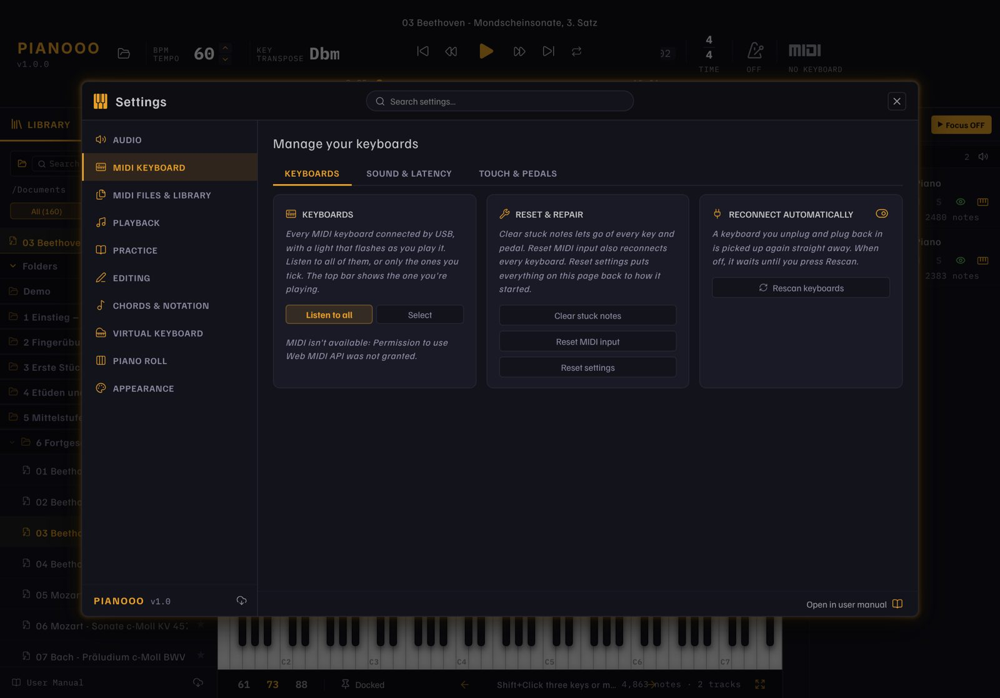

# Pianooo

[English](README.md) · **Deutsch** · [Français](README.fr.md) · [Español](README.es.md) · 🌐 [Website](https://hoai-droid.github.io/Pianooo/)

**Orfeo für iPad und Mac – Klavier lernen auf dem iPad und Mac** – mit fallenden Noten, echtem Notenblatt,
157 Stücken zum Start und Bluetooth-MIDI für dein Digitalpiano (z. B. Kawai ES120).

**📲 Download:**
[Pianooo.ipa (iPad)](https://github.com/HOAI-droid/Pianooo/releases/download/ipad-latest/Pianooo.ipa) ·
[Pianooo-Mac.zip (Mac)](https://github.com/HOAI-droid/Pianooo/releases/download/ipad-latest/Pianooo-Mac.zip)
– Installation: [SIDELOADING.md](SIDELOADING.md)

## 🎯 Üben, das dich besser macht

Pianooo hört auf dein Digitalpiano (Bluetooth- oder USB-MIDI). Tippe bei den fallenden Noten auf **Üben** und wähle:

<table>
<tr>
<td width="50%"> <b>⏳ Warte auf mich</b> Die Noten bleiben an der Linie stehen, bis du die richtigen Tasten drückst. Die gesuchten Tasten leuchten.</td>
<td width="50%"> <b>⏱️ Im Takt</b> Das Stück läuft im Tempo. Jede Note wird bewertet: pünktlich, zu früh, zu spät oder verpasst.</td>
</tr>
</table>

- **Deine Hand:** links, rechts oder beide – die App spielt den Rest (andere Hand, andere Instrumente)
- **Schneller werden:** mit 50 % Tempo starten; mit *Tempo automatisch steigern* gibt es nach jedem Durchgang mit mindestens 90 % richtig 5 % mehr Tempo, bis zum Originaltempo
- **Loop** um eine schwierige Stelle – jeder Durchgang mit eigener Trefferquote und Serie

## Was Pianooo kann

- **Fallende Noten oder Notenblatt** – umschaltbar, jeweils über die ganze Fläche
- **Notenblatt drucken** (AirPrint, DIN A4) und teilen
- **Start-Katalog mit 157 Stücken** in 7 Stufen: Clementis Klavierschule,
  Hanon, Czerny, Burgmüller, Bach, Beethoven, Chopin, Debussy, Joplin … –
  jeweils mit MIDI **und** Noten ([KATALOG.md](KATALOG.md))
- **Bluetooth- und USB-MIDI** – eigenes Piano anschließen, Tasten leuchten mit,
  Anschlag und Pedal werden übernommen
- **Eigene Songs:** MIDI, MusicXML, Guitar Pro, Capella aus Safari, Dateien oder
  AirDrop mit „Teilen › Pianooo“ öffnen; Noten-PDF mit gleichem Namen daneben
  legen, dann erscheint sie im Notenblatt
- Tempo, Transponieren, Loop, Metronom, Hand-Farben, Akkorderkennung, Mixer,
  Noten-Editor – alles aus Orfeo
- **Vier Sprachen:** Deutsch, Englisch, Französisch, Spanisch – startet in der Systemsprache
- Bedienung per Finger: Ziehen, Akkorde mit mehreren Fingern, langes Drücken
  = Kontextmenü

**Handbuch:** [docs/HANDBUCH.md](docs/HANDBUCH.md) – Bedienung, Notenblatt, eigene Songs, alle Einstellungen

Details zur iPad-Version, Bluetooth und zum Selberbauen: [IPAD.md](IPAD.md)

### Notenblatt und Einstellungen

<table>
<tr>
<td width="50%"> Notenblatt Seite für Seite, druckfertig (A4)</td>
<td width="50%"> Keyboard verbinden; Klang, Anschlag und Pedale</td>
</tr>
</table>

## Herkunft und Lizenz

Pianooo ist eine Weiterentwicklung von **[Orfeo](https://github.com/Squarebow/Orfeo)**
von **SquareBow** – vielen Dank! Die ursprüngliche Beschreibung steht in
[docs/ORFEO-README.md](docs/ORFEO-README.md).

- Code: **GPL-3.0-or-later** – © SquareBow (Orfeo) und Beiträge von HOAI-droid
  (iPad-Version), siehe [LICENSE.md](LICENSE.md) und
  [THIRD_PARTY_LICENSES.md](THIRD_PARTY_LICENSES.md)
- Klavier-Klänge zum Download: Kawai Upright (CC0) und Yamaha Disklavier Grand
  (CC BY 3.0) von [FreePats](https://freepats.zenvoid.org), Kawai ES100 Concert Grand
  (CC BY 3.0) von [GD Craft](https://musical-artifacts.com/artifacts/2922) – Quellen in der
  [Release „soundfonts“](https://github.com/HOAI-droid/Pianooo/releases/tag/soundfonts)
- Katalog: Notensätze und MIDI vom [Mutopia Project](https://www.mutopiaproject.org),
  gemeinfrei bzw. Creative Commons – Quellen in
  [public/Katalog/QUELLEN.md](public/Katalog/QUELLEN.md)
