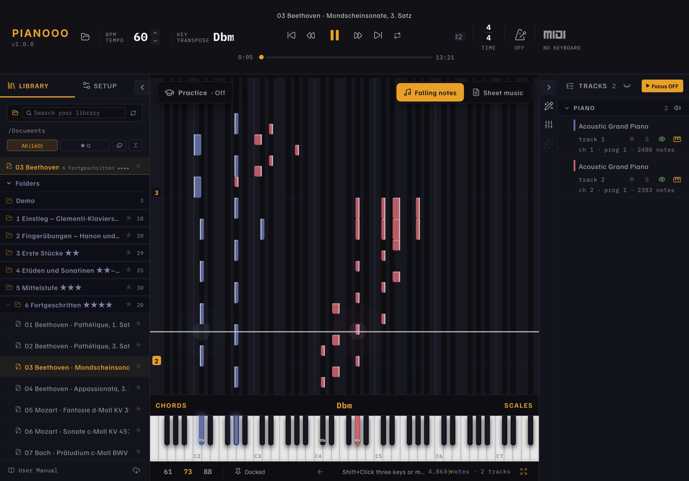
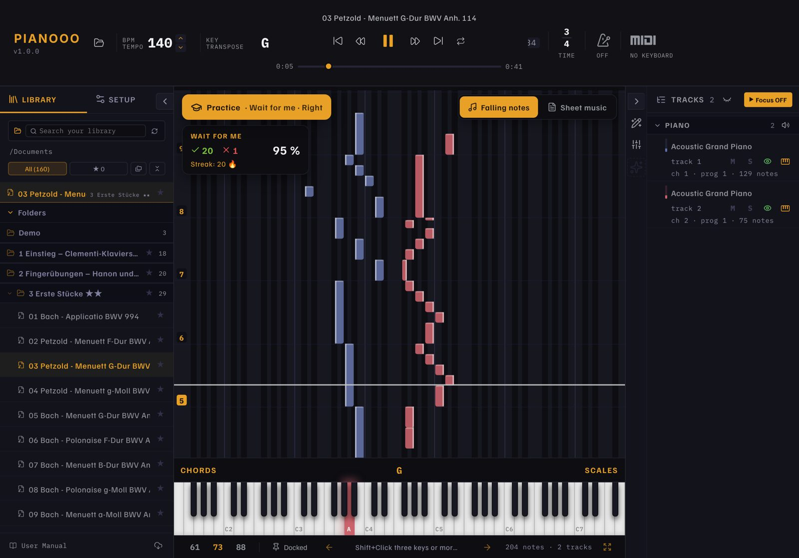
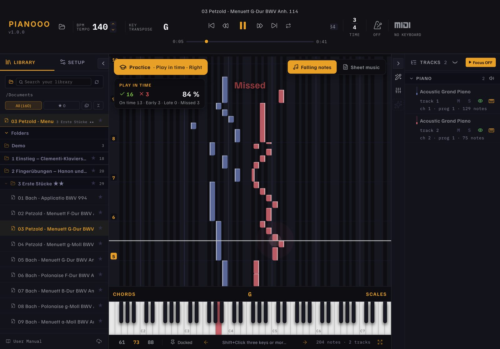
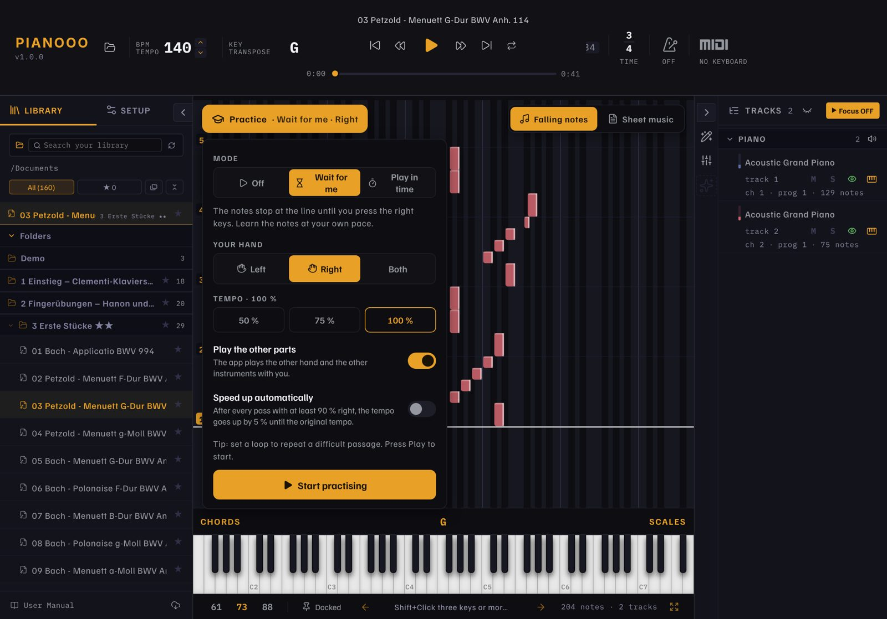
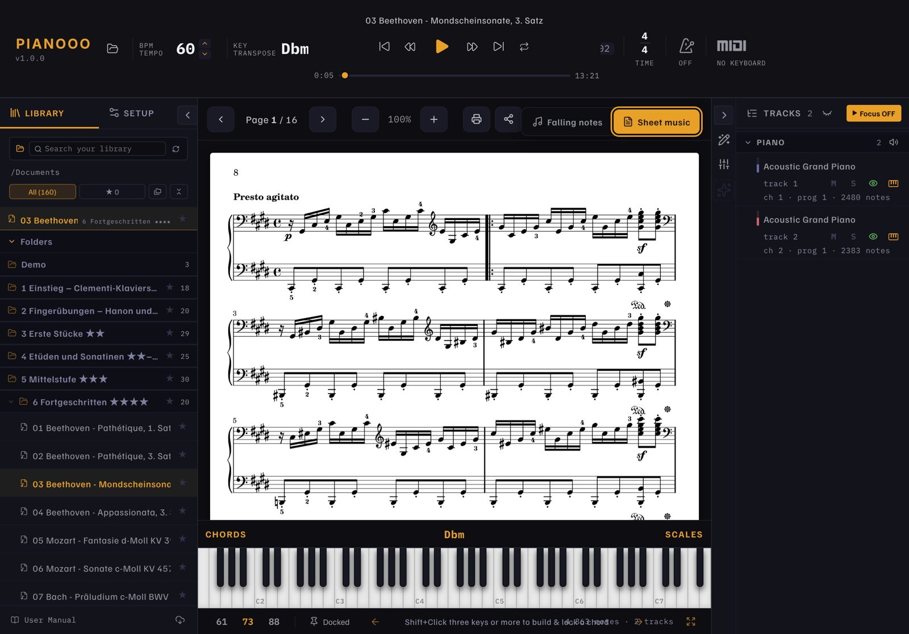
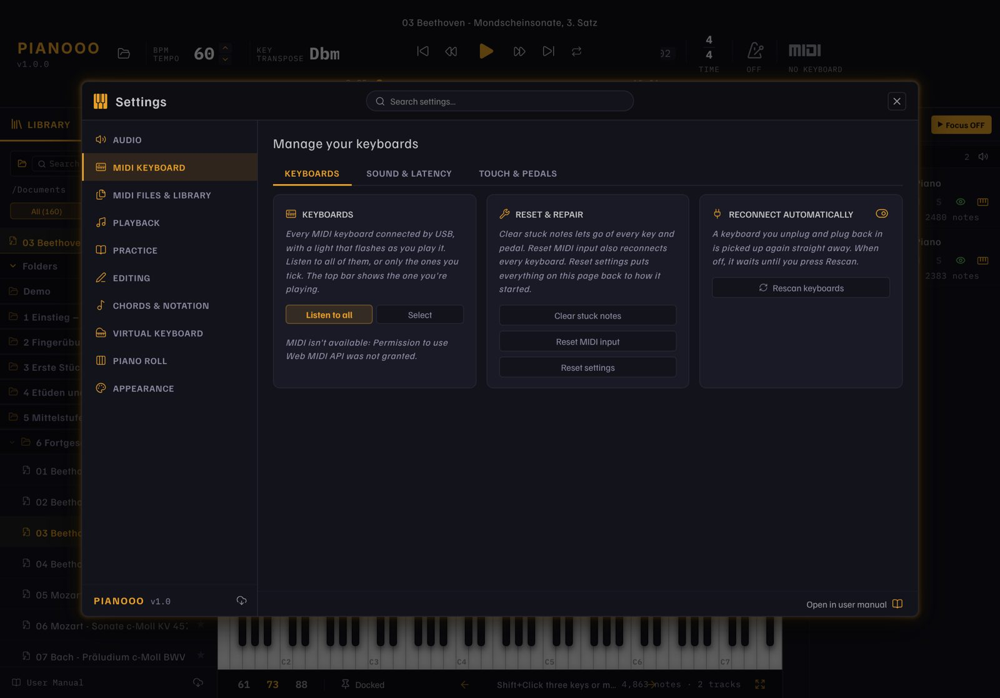

# Pianooo

[English](README.md) · [Deutsch](README.de.md) · [Français](README.fr.md) · **Español** · 🌐 [Sitio web](https://hoai-droid.github.io/Pianooo/?lang=es)

**Aprende piano en iPad y Mac** con notas que caen, partitura real,
157 piezas para empezar y MIDI Bluetooth para tu piano digital (por ejemplo un Kawai ES120).

**📲 Descarga:**
[Pianooo.ipa (iPad)](https://github.com/HOAI-droid/Pianooo/releases/download/ipad-latest/Pianooo.ipa) ·
[Pianooo-Mac.zip (Mac)](https://github.com/HOAI-droid/Pianooo/releases/download/ipad-latest/Pianooo-Mac.zip)
– instalación: ver el [sitio web](https://hoai-droid.github.io/Pianooo/?lang=es#install)

## 🎯 Práctica que te hace mejorar

Pianooo escucha tu piano digital (MIDI Bluetooth o USB). Toca **Práctica** en las notas que caen y elige:

**⏳ Espérame** – Las notas se detienen en la línea hasta que pulses las teclas correctas. Las teclas que tocar se iluminan.

**⏱️ A tempo** – La pieza avanza a tempo. Cada nota se valora: a tiempo, pronto, tarde o perdida.

- **Tu mano:** izquierda, derecha o ambas – la app toca el resto (otra mano, otros instrumentos)
- **Más rápido:** empieza al 50 % del tempo; con *acelerar automáticamente*, cada pasada con un 90 % de aciertos suma un 5 % hasta el tempo completo
- **Bucle** en un pasaje difícil – cada pasada con su puntuación y racha

## Qué hace Pianooo

- **Notas que caen o partitura** – cambia con un toque, cada vista ocupa toda la pantalla
- **Imprimir la partitura** (AirPrint, A4) y compartirla
- **Catálogo inicial de 157 piezas** en 7 niveles: método de Clementi, Hanon, Czerny,
  Burgmüller, Bach, Beethoven, Chopin, Debussy, Joplin … – cada una con MIDI **y** partitura
- **MIDI Bluetooth y USB** – conecta tu piano, las teclas se iluminan, se usan velocidad y pedal
- **Tus propias canciones:** abre archivos MIDI, MusicXML, Guitar Pro o Capella desde Safari,
  Archivos o AirDrop con «Compartir › Pianooo»; un PDF con el mismo nombre al lado muestra la
  partitura
- Tempo, transposición, bucle, metrónomo, colores de manos, detección de acordes, mezclador,
  editor de notas – todo de Orfeo
- **Cuatro idiomas:** español, inglés, alemán, francés – arranca en el idioma del sistema
- Control táctil: arrastrar, acordes con varios dedos, pulsación larga = menú contextual

### Partitura y ajustes

Partitura página a página, lista para imprimir (A4)

Conecta tu teclado; sonido, pulsación y pedales

## Origen y licencia

Pianooo se basa en **[Orfeo](https://github.com/Squarebow/Orfeo)** de **SquareBow**, una app
de código abierto para aprender piano en Windows – ¡muchas gracias! Pianooo es un proyecto
independiente, no una versión oficial de Orfeo.

- Código: **GPL-3.0-or-later** – © SquareBow (Orfeo) y contribuciones de HOAI-droid, ver
  [LICENSE.md](LICENSE.md) y [THIRD_PARTY_LICENSES.md](THIRD_PARTY_LICENSES.md)
- Sonidos de piano para descargar: [FreePats](https://freepats.zenvoid.org) y
  [GD Craft](https://musical-artifacts.com/artifacts/2922) – fuentes en la
  [release «soundfonts»](https://github.com/HOAI-droid/Pianooo/releases/tag/soundfonts)
- Catálogo: partituras y MIDI del [Mutopia Project](https://www.mutopiaproject.org),
  dominio público o Creative Commons – fuentes en
  [public/Katalog/QUELLEN.md](public/Katalog/QUELLEN.md)
