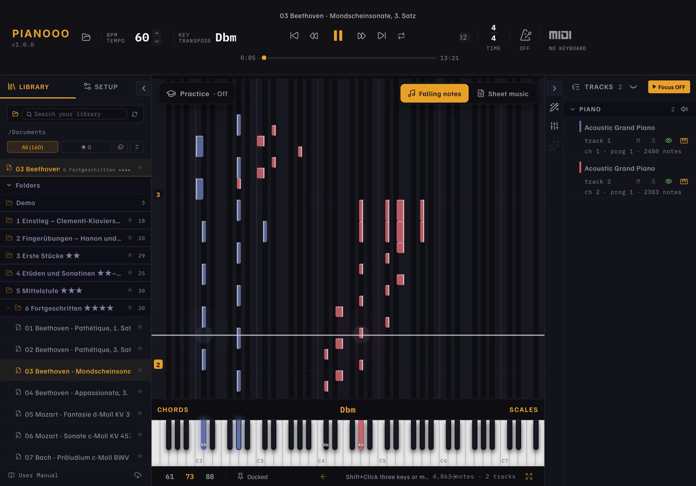
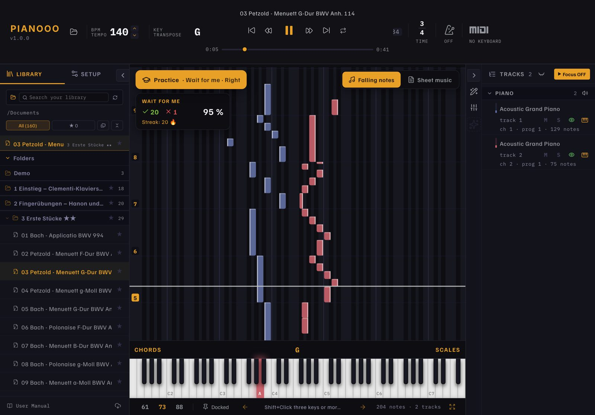
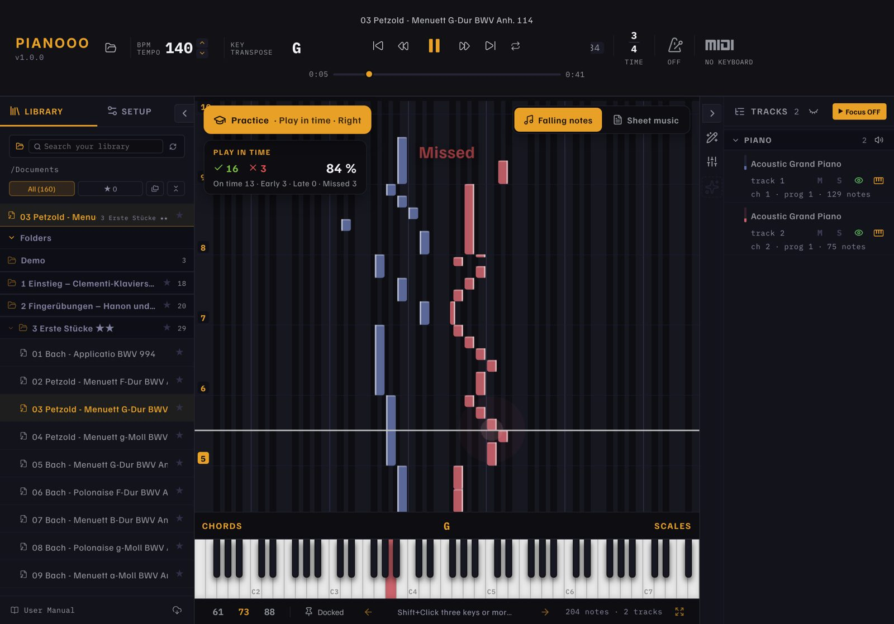
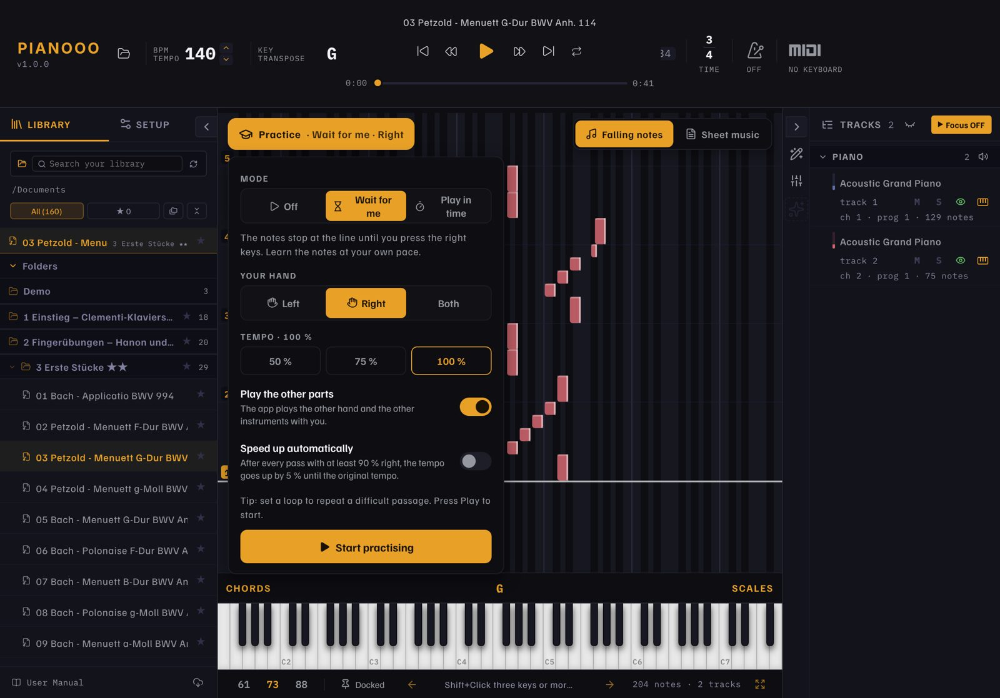
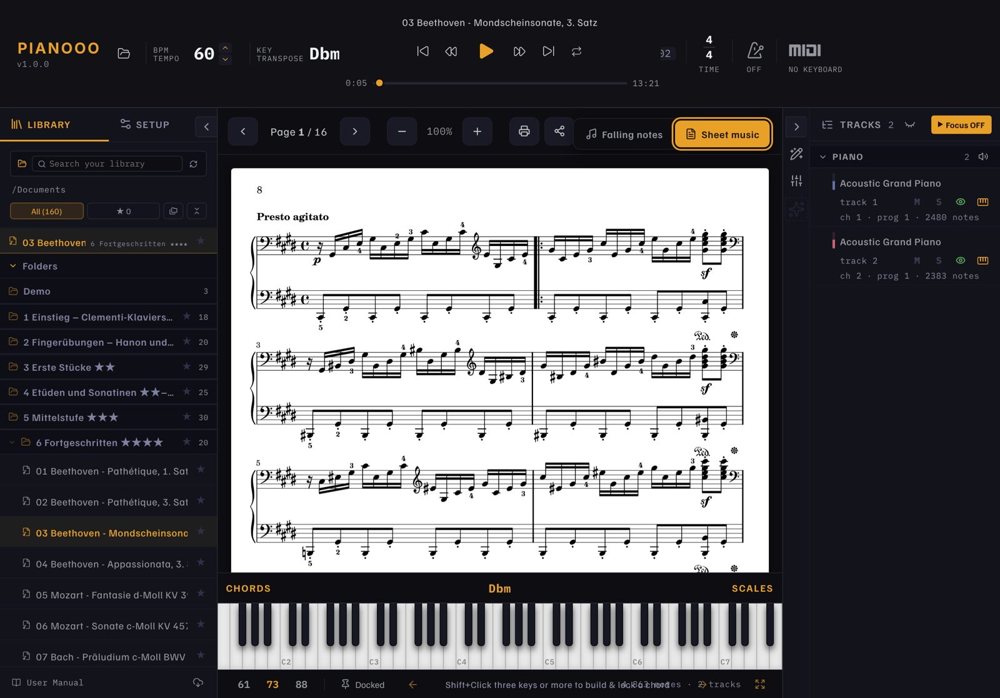
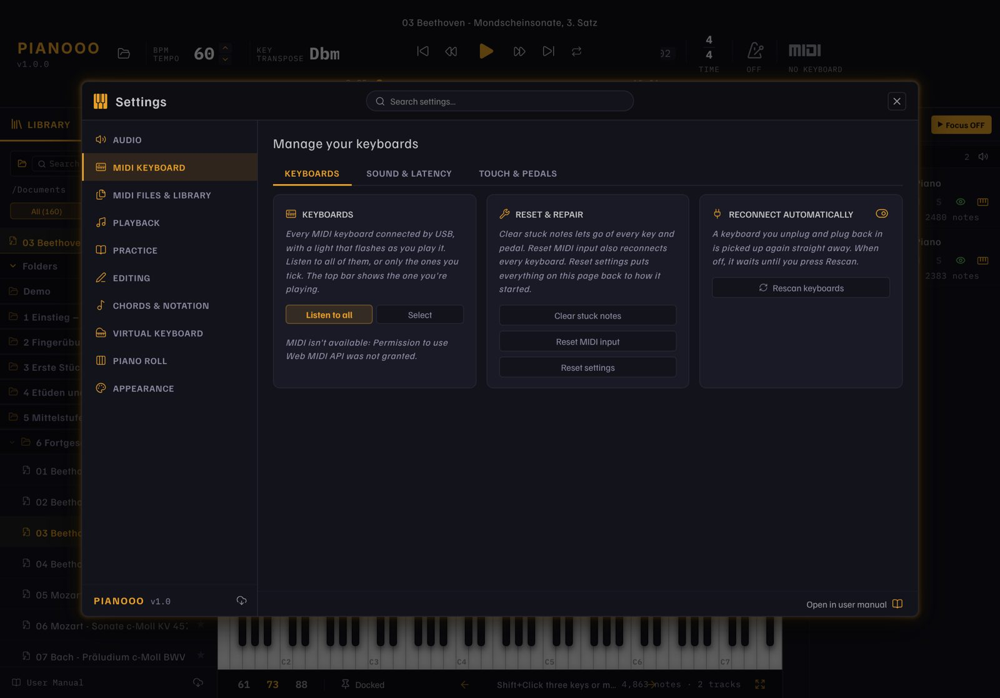

# Pianooo

[English](README.md) · [Deutsch](README.de.md) · **Français** · [Español](README.es.md) · 🌐 [Site web](https://hoai-droid.github.io/Pianooo/?lang=fr)

**Apprendre le piano sur iPad et Mac** avec des notes qui tombent,
une vraie partition, 157 pièces pour commencer et le MIDI Bluetooth pour votre piano numérique
(par exemple un Kawai ES120).

**📲 Téléchargement :**
[Pianooo.ipa (iPad)](https://github.com/HOAI-droid/Pianooo/releases/download/ipad-latest/Pianooo.ipa) ·
[Pianooo-Mac.zip (Mac)](https://github.com/HOAI-droid/Pianooo/releases/download/ipad-latest/Pianooo-Mac.zip)
– installation : voir le [site web](https://hoai-droid.github.io/Pianooo/?lang=fr#install)

## 🎯 Un entraînement qui vous fait progresser

Pianooo écoute votre piano numérique (MIDI Bluetooth ou USB). Touchez **Entraînement** sur le rouleau de notes et choisissez :

**⏳ Attends-moi** – Les notes s’arrêtent sur la ligne jusqu’à ce que vous jouiez les bonnes touches. Les touches à jouer s’allument.

**⏱️ En rythme** – Le morceau défile en tempo. Chaque note est évaluée : à temps, trop tôt, trop tard ou manquée.

- **Votre main :** gauche, droite ou les deux – l’app joue le reste (autre main, autres instruments)
- **Accélérez :** commencez à 50 % du tempo ; avec *accélérer automatiquement*, chaque passage réussi à 90 % ajoute 5 % jusqu’au tempo complet
- **Piano acoustique sans MIDI ?** Choisissez le **micro** : en mode *Attends-moi*, l’app écoute et vérifie les notes attendues – accords compris
- **Boucle** sur un passage difficile – chaque passage a son score et sa série

## Ce que fait Pianooo

- **Notes qui tombent ou partition** – basculez d'un geste, chaque vue occupe tout l'écran
- **Imprimer la partition** (AirPrint, A4) et la partager
- **Catalogue de départ de 157 pièces** en 7 niveaux : méthode de Clementi, Hanon, Czerny,
  Burgmüller, Bach, Beethoven, Chopin, Debussy, Joplin … – chacune avec MIDI **et** partition
- **MIDI Bluetooth et USB** – branchez votre piano, les touches s'allument, vélocité et pédale
  sont prises en compte
- **Vos propres morceaux :** ouvrez des fichiers MIDI, MusicXML, Guitar Pro ou Capella depuis
  Safari, Fichiers ou AirDrop avec « Partager › Pianooo » ; un PDF du même nom à côté affiche
  la partition
- Tempo, transposition, boucle, métronome, couleurs des mains, détection d'accords, console,
  éditeur de notes – tout vient d'Orfeo
- **Quatre langues :** français, anglais, allemand, espagnol – démarre dans la langue du système
- Commande tactile : glisser, accords à plusieurs doigts, appui long = menu contextuel

### Partition et réglages

Partition page par page, prête à imprimer (A4)

Connectez votre clavier ; son, toucher et pédales

## Origine et licence

Pianooo repose sur **[Orfeo](https://github.com/Squarebow/Orfeo)** de **SquareBow**, une app
open source d'apprentissage du piano pour Windows – un grand merci ! Pianooo est un projet
indépendant, pas une version officielle d'Orfeo.

- Code : **GPL-3.0-or-later** – © SquareBow (Orfeo) et contributions de HOAI-droid, voir
  [LICENSE.md](LICENSE.md) et [THIRD_PARTY_LICENSES.md](THIRD_PARTY_LICENSES.md)
- Sons de piano à télécharger : [FreePats](https://freepats.zenvoid.org) et
  [GD Craft](https://musical-artifacts.com/artifacts/2922) – sources dans la
  [release « soundfonts »](https://github.com/HOAI-droid/Pianooo/releases/tag/soundfonts)
- Catalogue : partitions et MIDI du [Mutopia Project](https://www.mutopiaproject.org),
  domaine public ou Creative Commons – sources dans
  [public/Katalog/QUELLEN.md](public/Katalog/QUELLEN.md)
