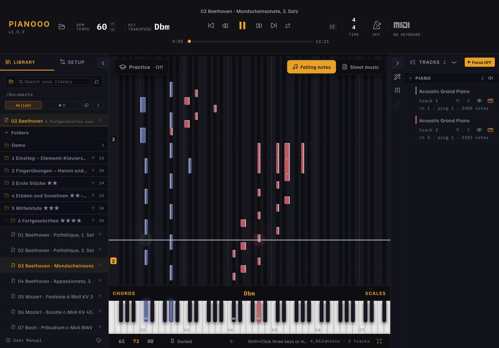
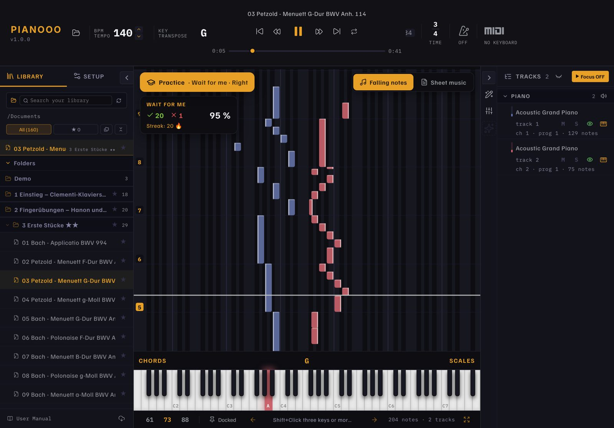
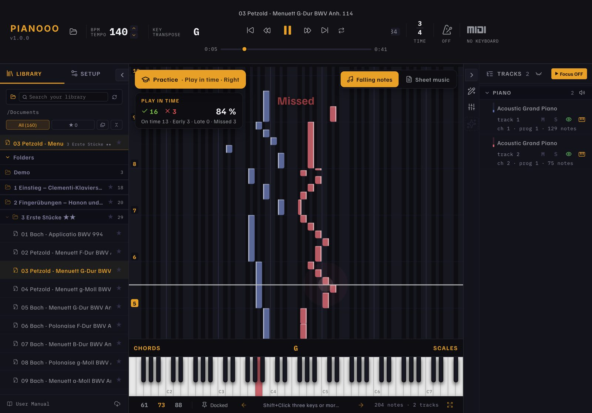
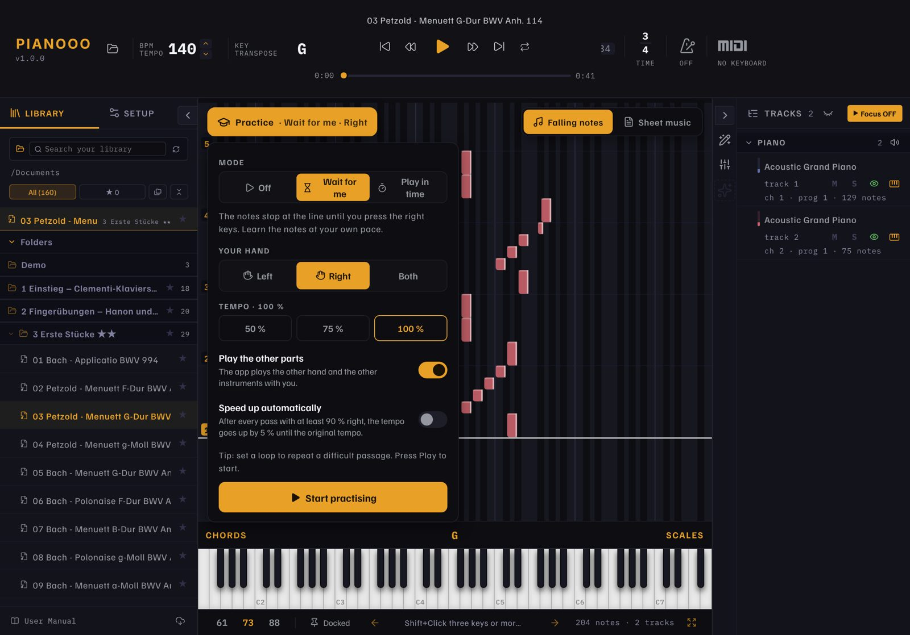
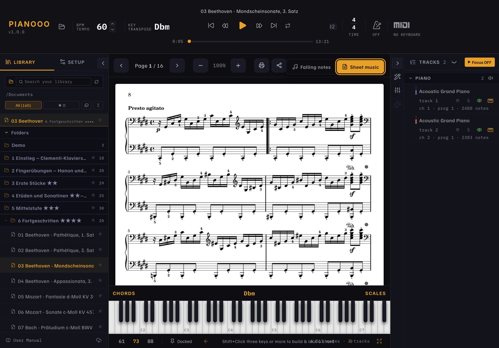
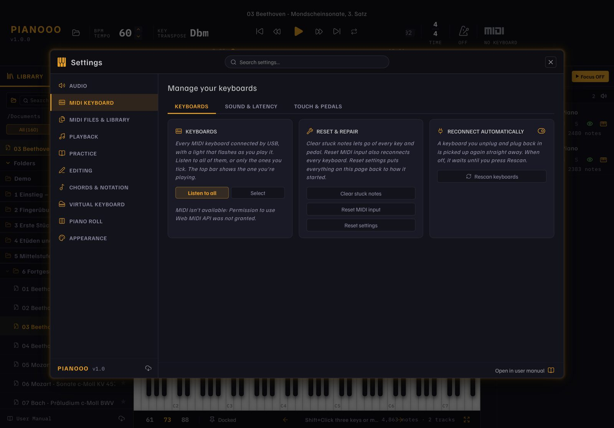

# Pianooo

**English** · [Deutsch](README.de.md) · [Français](README.fr.md) · [Español](README.es.md) · 🌐 [Website](https://hoai-droid.github.io/Pianooo/)

**Orfeo for iPad and Mac – learn piano on iPad and Mac** with falling notes, real sheet music,
157 pieces to start and Bluetooth MIDI for your digital piano (for example a Kawai ES120).

**📲 Download:**
[Pianooo.ipa (iPad)](https://github.com/HOAI-droid/Pianooo/releases/download/ipad-latest/Pianooo.ipa) ·
[Pianooo-Mac.zip (Mac)](https://github.com/HOAI-droid/Pianooo/releases/download/ipad-latest/Pianooo-Mac.zip)
– installation: [SIDELOADING.md](SIDELOADING.md) (German) or the [website](https://hoai-droid.github.io/Pianooo/#install)

## 🎯 Practice that makes you better

Pianooo listens to your digital piano (Bluetooth or USB MIDI). Tap **Practice** on the falling notes and choose:

**⏳ Wait for me** – The notes stop at the line until you press the right keys. The keys to play light up.

**⏱️ Play in time** – The song runs in tempo. Every note is rated: on time, early, late or missed.

- **Your hand:** left, right or both – the app plays the rest (other hand, other instruments)
- **Get faster:** start at 50 % tempo; with *speed up automatically*, every pass with at least 90 % right adds 5 % until full speed
- **Loop** a hard passage – every pass gets its own score, streak and accuracy

## What Pianooo does

- **Falling notes or sheet music** – switch with one tap, each view uses the whole screen
- **Print sheet music** (AirPrint, A4) and share it
- **Starter catalog of 157 pieces** in 7 levels: Clementi's piano method, Hanon, Czerny,
  Burgmüller, Bach, Beethoven, Chopin, Debussy, Joplin … – each with MIDI **and** sheet music
  ([KATALOG.md](KATALOG.md))
- **Bluetooth and USB MIDI** – connect your own piano, keys light up, velocity and pedal are used
- **Your own songs:** open MIDI, MusicXML, Guitar Pro or Capella files from Safari, Files or
  AirDrop with "Share › Pianooo"; put a PDF with the same name next to it to see its score
- Tempo, transpose, loop, metronome, hand colors, chord detection, mixer, note editor – all from Orfeo
- **Four languages:** English, German, French, Spanish – starts in your system language
- Touch control: drag, chords with several fingers, long press = context menu

**User manual** (German): [docs/HANDBUCH.md](docs/HANDBUCH.md) · iPad details, Bluetooth and
building it yourself: [IPAD.md](IPAD.md)

### Sheet music and settings

Sheet music, page by page, ready to print (A4)

Connect your keyboard; sound, touch and pedals

## Origin and license

Pianooo is based on **[Orfeo](https://github.com/Squarebow/Orfeo)** by **SquareBow**, an
open-source piano learning app for Windows – many thanks! Pianooo is an independent project,
not an official Orfeo release. The original description is in
[docs/ORFEO-README.md](docs/ORFEO-README.md).

- Code: **GPL-3.0-or-later** – © SquareBow (Orfeo) and contributions by HOAI-droid
  (iPad and Mac version), see [LICENSE.md](LICENSE.md) and
  [THIRD_PARTY_LICENSES.md](THIRD_PARTY_LICENSES.md)
- Piano sounds to download: Kawai Upright (CC0) and Yamaha Disklavier Grand
  (CC BY 3.0) from [FreePats](https://freepats.zenvoid.org), Kawai ES100 Concert Grand
  (CC BY 3.0) by [GD Craft](https://musical-artifacts.com/artifacts/2922) – sources in the
  [“soundfonts” release](https://github.com/HOAI-droid/Pianooo/releases/tag/soundfonts)
- Catalog: scores and MIDI from the [Mutopia Project](https://www.mutopiaproject.org),
  public domain or Creative Commons – sources in
  [public/Katalog/QUELLEN.md](public/Katalog/QUELLEN.md)
